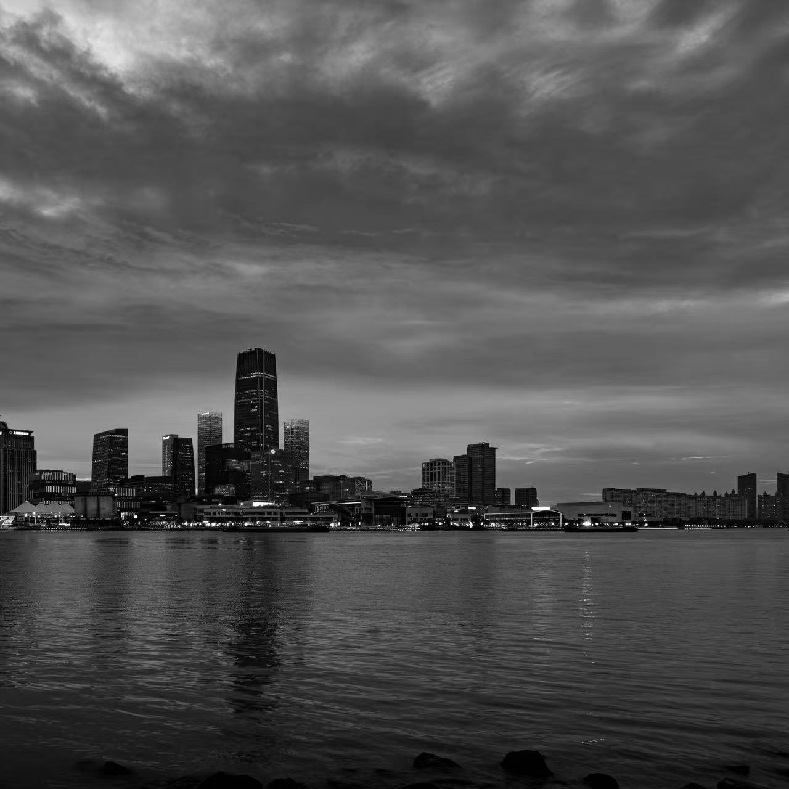
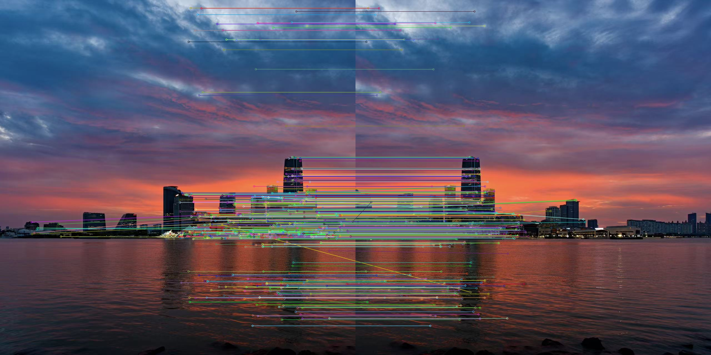

# 实验三：图像关键点检测及图像拼接

## 一、实验目的
本实验基于 SIFT 特征检测算法与 FLANN 特征匹配方法，实现两幅图像的特征点提取、匹配与自动拼接，掌握图像配准与融合的基本原理和实现方法。

## 二、实验内容
### 1. 导入库
```python
import os
import cv2
import numpy as np
```
### 2. 读取图像并预处理
读取两张拼接原素材，并转为灰度图。
```python
img_a = cv2.imread("a.jpg")
img_b = cv2.imread("b.jpg")
# 将图像转换为灰度图
gray_a = cv2.cvtColor(img_a, cv2.COLOR_BGR2GRAY)
gray_b = cv2.cvtColor(img_b, cv2.COLOR_BGR2GRAY)

cv2.imwrite("result/01_gray_a.jpg", gray_a)
cv2.imwrite("result/01_gray_b.jpg", gray_b)
print("img_a:", img_a.shape, "img_b:", img_b.shape)
```
结果图：

### 3. 关键点检测与特征匹配
先 SIFT 提取关键点与描述子，再用 FLANN 快速找到两幅图特征点的对应关系，然后通过 Lowe's 比率测试过滤不可靠匹配，只保留高质量匹配。
#### 初始化SIFT检测器并提取特征
```python
# 初始化SIFT检测器并提取特征
sift = cv2.SIFT_create()
kp_a, des_a = sift.detectAndCompute(gray_a, None)  # 图像a的关键点和描述符
kp_b, des_b = sift.detectAndCompute(gray_b, None)  # 图像b的关键点和描述符

print("kp_a:", len(kp_a), "des_a:", des_a.shape)
print("kp_b:", len(kp_b), "des_b:", des_b.shape)
```
```text
输出：
kp_a: 1768 des_a: (1768, 128)
kp_b: 1889 des_b: (1889, 128)
```
#### 使用FLANN匹配器进行特征匹配
```python
# 使用FLANN匹配器进行特征匹配
FLANN_INDEX_KDTREE = 1
index_params = dict(algorithm=FLANN_INDEX_KDTREE, trees=5)
search_params = dict(checks=50)  # 检查次数越多，匹配越准确但速度越慢
flann = cv2.FlannBasedMatcher(index_params, search_params)
matches = flann.knnMatch(des_a, des_b, k=2)  # k=2表示每个特征点返回2个最佳匹配

print("matches:", len(matches))
```
```text
输出：
matches: 1768
```
#### 应用Lowe's比率测试筛选优质匹配点
```python
# 应用Lowe's比率测试筛选优质匹配点
good_matches = []
for m, n in matches:
    if m.distance < 0.7 * n.distance:  # 比率阈值通常取0.7-0.8
        good_matches.append(m)

print("good_matches:", len(good_matches))
```
```text
输出：
good_matches: 661
```
#### 绘制匹配的SIFT关键点
```python
# 绘制匹配的SIFT关键点
matched_keypoints_img = cv2.drawMatches(
    img_a, kp_a, img_b, kp_b, good_matches,
    None, flags=cv2.DrawMatchesFlags_NOT_DRAW_SINGLE_POINTS
)

cv2.imwrite("result/02_good_matches.jpg", matched_keypoints_img)
print("已保存 result/02_good_matches.jpg")
```
结果图：

### 4. 图像拼接
#### 几何变换核心流程：
1. 坐标提取：src_pts 从源图 b 取匹配点，dst_pts 从基准图 a 取对应点，建立空间对应关系。
2. RANSAC 估计 H：鲁棒估计 3×3 单应矩阵，重投影阈值 5.0，剔除误匹配。
3. 画布尺寸：b 四角经 H 变换后与 a 四角合并，求包围盒最小/最大坐标，确定画布尺寸；用平移矩阵把负坐标移到正区域。
4. 变换与融合：translation_matrix @ H 对 b 透视变换+平移，再把 a 复制到对应位置。
#### 提取匹配点的坐标
```python
# 提取匹配点的坐标
src_pts = np.float32([kp_b[m.trainIdx].pt for m in good_matches]).reshape(-1, 1, 2)  # 图像b的关键
dst_pts = np.float32([kp_a[m.queryIdx].pt for m in good_matches]).reshape(-1, 1, 2)  # 图像a的关键

print("src_pts:", src_pts.shape, "dst_pts:", dst_pts.shape)
```
```text
输出：
src_pts: (661, 1, 2) dst_pts: (661, 1, 2)
```
#### 使用RANSAC算法估计单应矩阵
```python
# 使用RANSAC算法估计单应矩阵（透视变换矩阵）
H, _ = cv2.findHomography(src_pts, dst_pts, cv2.RANSAC, 5.0)

print("H =\n", H)
with open("result/03_homography.txt", "w") as f:
    f.write(np.array2string(H, precision=6, suppress_small=True))
```
```text
输出：
H =
 [[ 1.00146226e+00  1.45808397e-03  6.39568289e+02]
 [ 6.87393502e-05  1.00293340e+00 -1.38941178e+00]
 [ 8.13093303e-08  1.53564361e-06  1.00000000e+00]]
```
#### 计算图像b变换后的四个角点坐标
```python
# 获取输入图像尺寸
h_a, w_a = img_a.shape[:2]
h_b, w_b = img_b.shape[:2]

# 计算图像b变换后的四个角点坐标
pts = np.float32([[0, 0], [0, h_b], [w_b, h_b], [w_b, 0]]).reshape(-1, 1, 2)
dst_corners = cv2.perspectiveTransform(pts, H)

print("a:", (w_a, h_a), "b:", (w_b, h_b))
print("dst_corners:\n", dst_corners.reshape(-1, 2))
```
```text
输出：
a: (1280, 1280) b: (1280, 1280)
dst_corners:
 [[ 6.3956830e+02 -1.3894118e+00]
 [ 6.4017627e+02  1.2798496e+03]
 [ 1.9193339e+03  1.2798046e+03]
 [ 1.9212400e+03 -1.3012900e+00]]
```
#### 确定拼接后图像的最终尺寸
```python
# 确定拼接后图像的最终尺寸（包含所有像素）
all_corners = np.concatenate([dst_corners, np.float32([[0,0], [w_a,0], [w_a,h_a], [0,h_a]]).reshape(-1,1,2)], axis=0)
[x_min, y_min] = np.int32(all_corners.min(axis=0).ravel() - 0.5)
[x_max, y_max] = np.int32(all_corners.max(axis=0).ravel() + 0.5)

print("x_min:", x_min, "y_min:", y_min, "x_max:", x_max, "y_max:", y_max)
print("画布:", x_max - x_min, "x", y_max - y_min)
```
```text
输出：
x_min: 0 y_min: -1 x_max: 1921 y_max: 1280
画布: 1921 x 1281
```
#### 对图像b进行透视变换和平移
```python
# 创建平移矩阵，确保所有像素都在可见区域内
translation_matrix = np.array([[1, 0, -x_min], [0, 1, -y_min], [0, 0, 1]], dtype=np.float32)

# 对图像b进行透视变换和平移
stitched_img = cv2.warpPerspective(
    img_b,
    translation_matrix @ H,          # 组合平移矩阵和单应矩阵
    (x_max - x_min, y_max - y_min)   # 输出图像尺寸
)

cv2.imwrite("result/04_b_warped.jpg", stitched_img)
print("已保存 result/04_b_warped.jpg")
```
结果图：

#### 将图像a复制到拼接结果的对应位置
```python
# 将图像a复制到拼接结果的对应位置
stitched_img[-y_min : h_a - y_min, -x_min : w_a - x_min] = img_a

cv2.imwrite("result/05_stitched_result.jpg", stitched_img)
print("已保存 result/05_stitched_result.jpg")
```
结果图：


## 三、实验结果与分析
### 1. 特征检测与匹配效果分析
SIFT 在两幅图像中各检测到 1768、1889 个关键点，每个关键点生成 128 维描述子，说明图像纹理丰富、SIFT 检测能力较强。FLANN 以 k=2 做 KNN 匹配得到 1768 对初始匹配，经 Lowe's 比率测试（阈值 0.7）后保留 661 对优质匹配，保留比例约 37.4%，被过滤的约 62.6% 多为纹理相似区域产生的模糊匹配，说明比率测试有效剔除了区分度不足的对应关系。从 result/02_good_matches.jpg 可见，左右两图之间的连线方向基本一致、分布较均匀，优质匹配对整体几何一致性良好。
### 2. 单应矩阵与画布计算
以 b 的匹配点为源点、a 的匹配点为目标点，RANSAC（重投影阈值 5.0）从 661 对匹配中估计出单应矩阵 H，主对角元素接近 1（1.0015、1.0029），平移分量 tx≈639.57、ty≈-1.39，透视分量极小，说明两图主要差异为水平平移约 640 像素，几乎无旋转、缩放和透视畸变。b 经 H 变换后四角横坐标约在 640~1921 之间，与 a 的 [0,1280] 合并后得到画布 1921×1281；y_min=-1 说明变换后有约 1 像素超出上边界，平移矩阵将整体下移 1 像素，保证所有像素可见。
### 3. 拼接质量评估
从 result/04_b_warped.jpg 可见 b 变换后与 a 在水平方向正确错开约 640 像素、垂直方向对齐良好，无旋转/缩放畸变；从 result/05_stitched_result.jpg 可见最终拼接图中两图在重叠区域（约 640 像素宽）内容对齐良好，建筑物结构、边缘线条连续，无明显错位，验证了 SIFT+FLANN+RANSAC 流程的有效性。存在的不足是：拼接处有轻微亮度差异（拍摄光照不同所致）；放大观察时个别细节区域有微小配准误差（特征点定位精度限制或变换模型简化）；由于采用硬覆盖方式（a 直接复制到画布），重叠区以 a 的像素为准，拼接边界附近可能存在轻微接缝痕迹。此外，SIFT 特征点数量阈值、Lowe 比率阈值（0.7）、RANSAC 重投影阈值（5.0）、FLANN 的 trees 与 checks 等参数均会影响匹配数量与质量，需结合图像特点调整。
### 4. 结果汇总
图像 a 关键点 1768 个、b 关键点 1889 个；KNN 初始匹配 1768 对，Lowe 筛选后优质匹配 661 对（约 37.4%）；单应矩阵主要表现为水平平移约 640 像素；画布尺寸 1921×1281；最终输出文件 result/05_stitched_result.jpg。

## 四、实验小结
### 1. 技术收获
- SIFT 特征检测：SIFT 通过高斯金字塔与 DoG 空间检测尺度不变极值点，并基于局部梯度方向生成 128 维旋转不变描述子。本实验中两图各检测到 1768、1889 个关键点，说明 SIFT 对图像纹理和结构具有较强敏感性，且对尺度、旋转、光照变化保持鲁棒。
- FLANN + Lowe 比率测试：FLANN 通过 KD 树实现高效近似最近邻搜索，k=2 返回两个最近邻为比率测试提供依据。0.7 阈值下保留 37.4% 的匹配，说明比率测试能有效剔除纹理相似区域的模糊匹配，显著提升匹配可靠性。
- RANSAC 单应矩阵估计：从 661 对优质匹配中鲁棒估计 3×3 单应矩阵，重投影阈值 5.0 有效抑制外点。估计出的 H 主对角接近 1、平移分量约 640 px，与两图实际水平错位一致，说明估计结果准确。
- 透视变换与画布计算：通过变换 b 四角并联合 a 四角求包围盒，确定画布 1921×1281；平移矩阵处理了 y_min = -1 的负坐标问题，保证所有像素可见。translation_matrix @ H 一次性完成变换与平移，简化了流程。
### 2. 实践体会
- 参数调优的重要性：Lowe 比率阈值（0.7）直接决定匹配数量与质量的平衡；RANSAC 重投影阈值（5.0）影响内点筛选严格程度；FLANN 的 trees 与 checks 影响搜索精度与速度。这些参数需结合图像特点调整。
- 中间结果的价值：通过观察 02_good_matches.jpg 的连线分布、04_b_warped.jpg 的对齐情况以及 H 矩阵数值，可快速判断匹配质量与变换估计是否合理，是调试拼接流程的有效手段。
- 问题诊断：若匹配点过少，可放宽 Lowe 阈值或调整 SIFT 参数；若拼接错位，需检查 RANSAC 阈值或匹配点分布；若出现黑边，属于透视变换空白区域，可通过画布包围盒计算消除负坐标问题。
### 3. 改进方向
- 接缝融合：当前为硬覆盖拼接，重叠区可能有亮度差异或接缝。可改用加权融合、羽化或多频段融合消除接缝。
- 变换模型：单应矩阵假设场景近似平面或相机绕光心旋转。对大视差场景，可改用柱面/球面投影或分段拼接。
- 多图拼接：当前仅支持两图，多图需累积变换矩阵或使用 cv2.Stitcher_create()。
- 性能优化：SIFT 计算较慢，实时场景可换 ORB + BFMatcher(Hamming)，或对 SIFT 做 GPU 加速。
### 4. 总结
本实验完整实现了基于 SIFT + FLANN + RANSAC 的两图自动拼接流程，从 1768 对初始匹配中筛选出 661 对优质匹配，鲁棒估计出以水平平移为主（≈640 px）的单应矩阵，最终生成 1921×1281 的拼接图像。实验结果表明该流程对存在平移、轻微视角差异的图像具有良好拼接效果，同时也让我深入理解了特征检测、特征匹配、鲁棒估计与几何变换在计算机视觉中的协同作用。


