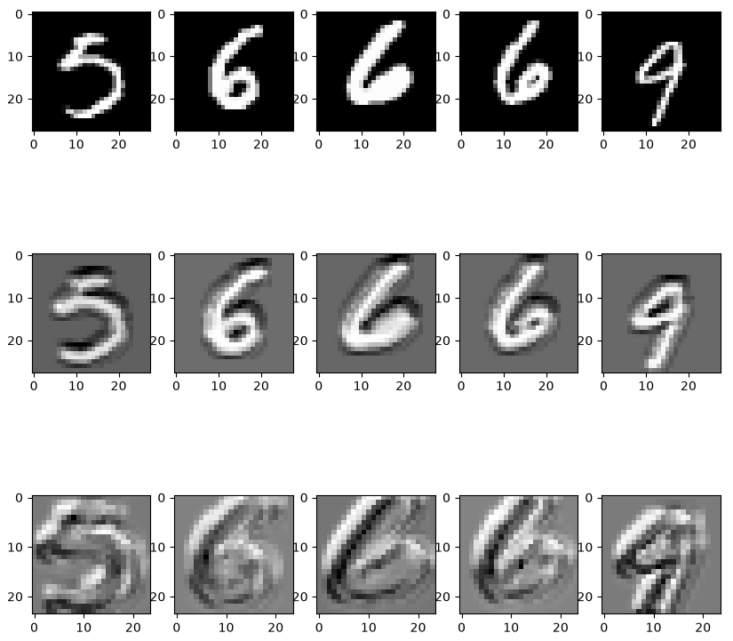

# 实验五：CNN-卷积神经网络
## 一、实验目的
本实验是基于LeNet的卷积神经网络实验，通过训练MNIST手写数字分类模型并结合可视化，旨在通过构建卷积神经网络，掌握卷积层、池化层和全连接层在图像分类中的作用，理解卷积与池化对图像特征的提取过程。

## 二、实验内容

### 1.导入必要库

使用 PyTorch 构建和训练模型，使用 torchvision 加载 MNIST 和转换图像，使用 Matplotlib 绘制特征图。导入这些库前，将 Intel oneMKL 的线程层设置为顺序模式，具体原因见第四部分。

```python
import os

os.environ['MKL_THREADING_LAYER'] = 'SEQUENTIAL'

import torch
import torch.nn as nn
import torch.nn.functional as F
import torch.optim as optim
from torchvision import datasets,transforms
import matplotlib.pyplot as plt
```

### 2.设置超参数和设备

每批最多处理 512 张图像。有可用的 CUDA 设备时使用 GPU，否则使用 CPU。训练和测试时将模型、图像和标签移到同一设备。

```python
batch_size = 512
device = torch.device('cuda' if torch.cuda.is_available() else 'cpu')
```

### 3.加载数据

MNIST 的训练集和测试集分别包含 60,000 张和 10,000 张 `28×28` 灰度图像，标签为 0–9。打印的形状来自数据集的原始像素数组。`ToTensor()` 在加载样本时添加通道维度，并将像素值从 `[0, 255]` 缩放到 `[0, 1]`，因此单张图像送入模型前的形状为 `1×28×28`。

```python
trainloader = torch.utils.data.DataLoader(datasets.MNIST('data',train=True,download = True,
              transform=transforms.Compose([transforms.ToTensor()])),batch_size=batch_size,shuffle=True)
testloader = torch.utils.data.DataLoader(datasets.MNIST('data',train=False,download=True,
              transform=transforms.Compose([transforms.ToTensor()])),batch_size=batch_size,shuffle=True)
print("训练数据形状:", trainloader.dataset.data.shape)
print("测试数据形式:", testloader.dataset.data.shape)
```
```text
输出：
训练数据形状: torch.Size([60000, 28, 28])
测试数据形式: torch.Size([10000, 28, 28])
```

### 4.创建模型

LeNet 由两组卷积、Sigmoid 激活和平均池化，以及三个全连接层组成。第一层卷积使用两圈零填充，保留输入宽高。两次池化均使用 `2×2` 窗口和步长 2。第二次池化后，将每张图像的 `16×5×5` 个特征展开为 400 维向量。分类层输出 10 个原始分数，直接用于交叉熵计算。模型使用 Adam 优化器，学习率为 `0.01`。

| 阶段 | 单个样本的输出形状 |
| --- | --- |
| 输入图像 | `1×28×28` |
| 第一次卷积和第一次池化 | `6×28×28 → 6×14×14` |
| 第二次卷积和第二次池化 | `16×10×10 → 16×5×5` |
| 展平和全连接 | `400 → 120 → 84 → 10` |

```python
class Net(nn.Module):
  def __init__(self):
    super(Net,self).__init__()
    self.conv1 = nn.Conv2d(1,6,kernel_size=5,padding=2)  #输入通道1, 输出通道6, 卷积核5x5,padding=2
    self.conv2 = nn.Conv2d(6,16,kernel_size=5)  #输入通道6, 输出通道16, 卷积核5x5
    self.fc1 = nn.Linear(5*5*16,120)  #全连接层，输入5*5*16, 输出120
    self.fc2 = nn.Linear(120,84)  #全连接层，输入120, 输出84
    self.clf = nn.Linear(84,10)  #分类层，输入84, 输出10

  def forward(self,x):
    #conv1
    x = self.conv1(x)
    #激活函数sigmoid()
    x = torch.sigmoid(x)
    #平均池化层，kernel=2x2, 步长2
    x = F.avg_pool2d(x,kernel_size=2,stride=2)

    #conv2
    x = self.conv2(x)
    #激活函数sigmoid()
    x = torch.sigmoid(x)
    #平均池化层，2x2, 步长2
    x = F.avg_pool2d(x,kernel_size=2,stride=2)

    #展平，从第1维开始展平
    x = torch.flatten(x,1)

    #全连接层1
    x = self.fc1(x)
    #激活函数sigmoid()
    x = torch.sigmoid(x)

    #全连接层2
    x = self.fc2(x)
    #激活函数sigmoid()
    x = torch.sigmoid(x)

    #分类层
    x = self.clf(x)
    return x


model = Net().to(device)
optimizer = optim.Adam(model.parameters(), lr = 1e-2)
model
```
```text
输出：
Net(
  (conv1): Conv2d(1, 6, kernel_size=(5, 5), stride=(1, 1), padding=(2, 2))
  (conv2): Conv2d(6, 16, kernel_size=(5, 5), stride=(1, 1))
  (fc1): Linear(in_features=400, out_features=120, bias=True)
  (fc2): Linear(in_features=120, out_features=84, bias=True)
  (clf): Linear(in_features=84, out_features=10, bias=True)
)
```

### 5.训练与测试

模型共训练 30 轮。每个训练批次先清除上一批的梯度，再进行前向传播、计算交叉熵、反向传播和参数更新。每轮训练结束后，在 `torch.no_grad()` 下遍历测试集，取每张图像分数最高的类别作为预测结果。准确率按预测正确的样本数除以测试集样本总数计算，损失和准确率分别记录在 `losses` 和 `accs` 中。

```python
epochs = 30
accs,losses = [], []
for epoch in range(epochs):
  for batch_idx,(x,y) in enumerate(trainloader):
    x,y = x.to(device),y.to(device)
    optimizer.zero_grad()
    out = model(x)
    loss = F.cross_entropy(out,y)
    loss.backward()
    optimizer.step()

  correct = 0
  testloss = 0
  with torch.no_grad():
    for batch_idx,(x,y) in enumerate(testloader):
      x,y = x.to(device),y.to(device)
      out = model(x)
      testloss += F.cross_entropy(out,y).item()
      pred = out.max(dim=1,keepdim=True)[1]
      correct += pred.eq(y.view_as(pred)).sum().item()

  acc = correct/len(testloader.dataset)
  testloss = testloss/(batch_idx+1)
  accs.append(acc)
  losses.append(testloss)
  print('epoch:{}, loss:{:.4f}, acc:{:.4f}'.format(epoch,testloss,acc))
```
```text
输出：
epoch:0, loss:2.3018, acc:0.1135
epoch:1, loss:2.3014, acc:0.1135
epoch:2, loss:1.9102, acc:0.2204
epoch:3, loss:0.7870, acc:0.6935
epoch:4, loss:0.4014, acc:0.8494
epoch:5, loss:0.2564, acc:0.9184
epoch:6, loss:0.1762, acc:0.9481
epoch:7, loss:0.1289, acc:0.9598
epoch:8, loss:0.1157, acc:0.9665
epoch:9, loss:0.1171, acc:0.9651
epoch:10, loss:0.0859, acc:0.9721
epoch:11, loss:0.1241, acc:0.9619
epoch:12, loss:0.0848, acc:0.9740
epoch:13, loss:0.0916, acc:0.9717
epoch:14, loss:0.0803, acc:0.9755
epoch:15, loss:0.0774, acc:0.9768
epoch:16, loss:0.1006, acc:0.9706
epoch:17, loss:0.0640, acc:0.9801
epoch:18, loss:0.0773, acc:0.9752
epoch:19, loss:0.0626, acc:0.9802
epoch:20, loss:0.1096, acc:0.9679
epoch:21, loss:0.0625, acc:0.9806
epoch:22, loss:0.0849, acc:0.9731
epoch:23, loss:0.0828, acc:0.9760
epoch:24, loss:0.0796, acc:0.9751
epoch:25, loss:0.0673, acc:0.9798
epoch:26, loss:0.0572, acc:0.9829
epoch:27, loss:0.0641, acc:0.9811
epoch:28, loss:0.0672, acc:0.9792
epoch:29, loss:0.0605, acc:0.9816
```

### 6.特征图可视化

取最后一个测试批次中的前 5 张图像。每列对应一个样本，从上到下依次显示原图、第一层卷积的激活结果和第二层卷积的激活结果。每个卷积层的多个通道沿通道维度相加，合成一张灰度图，便于查看同一数字在两层中的响应变化。

```python
feature1 = F.sigmoid(model.conv1(x))
# feature1 = F.avg_pool2d(feature1,kernel_size=2,stride=2)
feature2 = F.sigmoid(model.conv2(feature1))
# feature2 = F.avg_pool2d(feature2,kernel_size=2,stride=2)

n = 5
img = x.detach().cpu().numpy()[:n]
feature_map1 = feature1.detach().cpu().numpy()[:n]
feature_map2 = feature2.detach().cpu().numpy()[:n]

fig, ax = plt.subplots(3, n, figsize=(10,10))
for i in range(n):
  ax[0,i].imshow(img[i].sum(0),cmap='gray')
  # ax[0,i].axis('off')
  ax[1,i].imshow(feature_map1[i].sum(0),cmap='gray')
  # ax[1,i].axis('off')
  ax[2,i].imshow(feature_map2[i].sum(0),cmap='gray')
  # ax[1,i].axis('off')
plt.show()
```

## 三、实验结果与分析

### 1. 分类结果

本次运行的代表性结果如下。表中轮次从 1 开始，Notebook 日志中的 `epoch` 从 0 开始。

| 训练轮次 | 测试损失 | 测试准确率 |
| --- | ---: | ---: |
| 1 | 2.3018 | 11.35% |
| 6 | 0.2564 | 91.84% |
| 8 | 0.1289 | 95.98% |
| 18 | 0.0640 | 98.01% |
| 27 | 0.0572 | 98.29% |
| 30 | 0.0605 | 98.16% |

前两轮的准确率均为 11.35%，随后准确率快速上升，第 8 轮达到 95.98%。后期准确率在 98% 附近波动。第 27 轮同时取得本次运行的最高测试准确率 **98.29%** 和最低测试损失 **0.0572**。第 30 轮的准确率为 **98.16%**，对应 10,000 张测试图像中有 9,816 张分类正确。

当前测试损失是各批次平均损失的算术平均值。最后一个批次有 272 张图像，却和其他 512 张图像的批次权重相同。如果需要报告按样本平均的损失，可以累加各批次损失之和，再除以测试集样本总数。表中的数值保留本次 Notebook 的实际记录。

### 2. 特征图分析



第一层特征图基本保留了数字轮廓，在笔画及其边缘形成明显的亮暗变化。第二层组合了第一层的响应，笔画与附近背景的亮暗分布进一步发生变化。图中每张特征图汇总了整层响应，适合比较两层的空间变化。观察某个卷积核的作用时，可以单独查看对应通道。

可视化代码将第一次平均池化留在注释中，直接把 `28×28` 的第一层响应送入第二层卷积，因此图中的第二层特征图是 `24×24`。实际模型的 `forward()` 会先把第一层响应池化到 `14×14`，随后卷积得到 `10×10` 的第二层特征图。

## 四、实验总结与心得

本实验完成了 MNIST 数据加载、LeNet 构建、模型训练和特征图绘制。逐层核对张量形状后，可以把代码中的参数与实际输出对应起来。卷积核的数量决定输出通道数，填充和步长影响特征图宽高。两次平均池化之后，必须按实际输出计算展平长度，否则全连接层会因输入维度不匹配而报错。比较原图和两层卷积的响应后，也能直观看到同一笔画经过不同卷积层后形成的亮暗变化。

### 绘图时的 MKL 线程冲突

在 Windows 的 `Python (cv)` 内核中，训练和测试可以完成，但运行可视化单元时曾发生内核崩溃。本地复现时，错误日志显示 Intel OpenMP 运行库 `libiomp5md.dll` 被重复初始化。

解决时，将以下两行放在 Notebook 第一个代码单元的开头，在导入 PyTorch、torchvision 和 Matplotlib 之前执行。已有内核可能已经加载相关库，需要先重启内核，再从头运行所有单元。

```python
import os
os.environ['MKL_THREADING_LAYER'] = 'SEQUENTIAL'
```

该设置让 Intel oneMKL 在当前进程中使用单线程模式。应用设置后，Notebook 保存了完整的 30 轮日志和由 15 张子图组成的特征图。